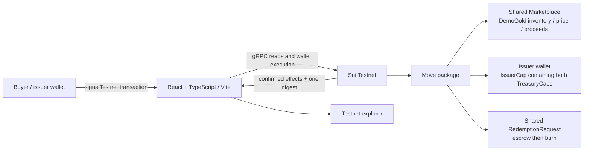

# Aurum

**Expo migration:** a shared iOS, Android and web app is now in [`mobile/`](mobile/README.md). It shares the amount rules and chain API with this Vite app. Native signing currently hands off to the hosted Expo web app inside Slush's browser. See its README for run commands and [actual validation limits](mobile/VALIDATION.md).

**Two assets. One transaction. Independently verifiable settlement.**

A fixed-price marketplace for simulated gold on **Sui Testnet**, built as a university blockchain project and software engineering portfolio. Buyers exchange MockUSD for DemoGold in one Move call. The receipt reads confirmed network balance changes and links to the same transaction in a Testnet explorer.

Both assets are simulations with **no physical backing, monetary value, investment purpose or physical redemption**. This is a storefront, not an exchange order book. Network gas uses Testnet SUI, separate from MockUSD.

> **Current handoff, 2026-11-18:** fourteen local tests, Expo type checking, web/Android/iOS JavaScript exports and all seven Move tests pass. The user also completed the normal Move build. The Expo web app runs locally at `http://localhost:8081`. Browser click testing, native device runtime, wallet connection and Testnet deployment remain unverified. The legacy Vite dependency alignment is recorded separately. No package ID or transaction digest is invented. Original results and contract follow-up: [VALIDATION.md](VALIDATION.md); current Expo results: [mobile/VALIDATION.md](mobile/VALIDATION.md).

## Run locally

For the complete **Expo web + connected-wallet funding** flow, start from the repository root with `npm.cmd run demo`. Connect Slush and use **Get 250 demo MockUSD**; no buyer address needs to be pasted into chat or a terminal. The local issuer service prepares an empty marketplace once, verifies ownership messages, confirms fixed claims and attempts buyer gas funding. See [demo funding setup and limits](docs/DEMO_FUNDING.md). It requires the already configured Testnet issuer CLI account and network access.

Requirements: Node.js 24+, npm, and (for contracts) the Testnet-compatible Sui CLI. Commands below use PowerShell; `npm.cmd` avoids PowerShell's script execution policy issue on Windows. On macOS/Linux use `npm`.

```powershell
cd "D:\Coding\Gold Tokenization\mobile-tokenization-app"
npm.cmd install
Copy-Item .env.example .env.local
npm.cmd run dev
```

Open the Vite URL, normally **http://127.0.0.1:5173**. Without real deployment IDs, the app displays setup guidance and disables network purchase operations. **Explore a sample rehearsal** enables interactive browser-only balances. Those actions never generate a digest, explorer link or claim of on-chain settlement. Sample state resets on reload.

Dependencies are pinned in `package.json`. A Vite `package-lock.json` was subsequently generated outside the agent turn and has been preserved. The root SDK pin is now aligned to the installed dApp Kit core's required 2.39.1; run `npm install` to refresh that lock before using `npm ci`. Offline regeneration was blocked. The Expo app has its own package manifest and still needs a successful installation and generated lockfile. There was no existing Git repository convention to preserve.

The interface uses forest green, warm ivory and gold, with responsive storefront, portfolio and issuer views. Gold bars are CSS artwork. A screenshot is intentionally not included because the actual frontend could not be built or browser-tested here; capture the running app after validation rather than publishing a mock screenshot.

## Architecture



`purchase` receives one `Coin<MOCK_USD>`, withdraws DemoGold from the marketplace, sends the fixed price to the stored seller address, returns excess MockUSD and emits a purchase event. All commands commit or abort together. The frontend uses `coinWithBalance` to resolve coin inputs; it normally overpays by 1 mUSD when the balance permits so on-chain change handling is exercised.

The buyer cannot pass a price or proceeds recipient. There is no public mint function without an issuer capability and no purchase-time access to a treasury. Issuance is deliberately centralized and simulated; package upgrades are also an issuer trust assumption while the publisher retains its upgrade capability.

### Source map

| Path | Responsibility |
| --- | --- |
| `contracts/sources/mock_usd.move` | MockUSD one-time witness and metadata |
| `contracts/sources/demo_gold.move` | DemoGold one-time witness and metadata |
| `contracts/sources/marketplace.move` | Inventory, capability, atomic purchase, transfers and redemption |
| `contracts/tests/marketplace_tests.move` | Seven Move scenarios |
| `src/marketplace-api.ts` | Shared Testnet gRPC reads, BCS schemas and transaction builders |
| `src/chain.ts` | Vite environment and wallet adapter for the shared API |
| `src/domain.ts` | Exact amounts, validation and settlement matching |
| `src/App.tsx` | Storefront, portfolio, issuer dashboard and receipts |
| `scripts/seed.ps1` | Issuer-only inventory and buyer funding |
| `scripts/prove-atomicity.mjs` | Read-only verification of a real receipt and underpayment dry run |

## Units and permissions

| Asset | Move type suffix | Symbol | Decimals | One whole unit |
| --- | --- | --- | --- | --- |
| MockUSD | `mock_usd::MOCK_USD` | mUSD | 6 | 1,000,000 base units |
| DemoGold | `demo_gold::DEMO_GOLD` | dGOLD | 6 | 1,000,000 base units |

**Fixed price: 100 MockUSD = 1 DemoGold.** Both assets use six decimals, so the contract multiplies gold base units by **100** to get the MockUSD cost. For example, 0.5 dGOLD = 500,000 gold base units costs 50,000,000 MockUSD base units. A DemoGold unit does not assert ownership of a gram or ounce of actual gold.

Amounts are `u64` in Move and `bigint` in TypeScript. Quantity must be positive and no greater than `floor(U64_MAX / 100)`. UI inputs support up to six fractional digits and reject floats, exponent notation and overflow. The market's price and proceeds address are set at initialization and have no public setters.

| Action | Required authority |
| --- | --- |
| Initialize marketplace | Own and consume both asset TreasuryCaps |
| Purchase from funded inventory | Buyer-owned MockUSD coin, no issuer authority |
| Transfer DemoGold | Ownership of the transferred coin |
| Request redemption | Ownership of the surrendered coin |
| Mint inventory | Mutable matching `IssuerCap` and marketplace |
| Mint MockUSD to a buyer | Mutable `IssuerCap` |
| Complete redemption and burn | Mutable matching `IssuerCap` and pending request |

Initialization consumes both unique TreasuryCaps into a wallet-owned `IssuerCap`. This capability has `key` **without `store`**, so callers cannot publicly transfer or share it through generic transfer APIs. There is no endpoint to extract either treasury. The Move object ownership rules prevent a buyer from borrowing the issuer's capability. Market-bound administration additionally checks the capability's marketplace ID.

At publication, the two asset TreasuryCaps and the package UpgradeCap initially belong to the publisher. Initialize immediately using the same dedicated issuer account. Retain all privileged capabilities in the issuer wallet; never place them in a shared object or frontend configuration.

The asset modules use the still-supported `coin::create_currency` API for a small, interview-friendly CoinMetadata/OTW model. It is deprecated in favor of `coin_registry::new_currency_with_otw` for new registry integrations. No registry integration is claimed; Move build compatibility remains to be checked with the installed Testnet CLI.

### Redemption lifecycle

1. The holder calls `request_redemption`. The entire supplied coin becomes a balance in a shared `RedemptionRequest`; the holder no longer owns or can transfer those tokens. **Status 0: surrendered, pending in escrow.**
2. The issuer reviews the request and calls `complete_redemption`. The matching capability authorizes a burn of exactly the escrowed quantity. **Status 1: burned, simulated redemption complete.** Escrow is empty and total supply decreases.
3. Completion cannot repeat. The request object remains as a persistent status record and both transitions emit events.

Escrow separates a holder's request from the issuer's completion decision and makes the pending state inspectable. There is no cancellation, refund, physical delivery or external fulfillment service in this small simulation. Do not describe a pending request as burned, or a completed request as physical redemption.

## Contract and frontend checks

Install the CLI using the current [official installation guide](https://docs.sui.io/getting-started/onboarding/sui-install). On a supported shell with `suiup`, select the Testnet toolchain:

```text
suiup install sui@testnet
sui --version
```

The official guide also documents Windows installation options. Record the actual version returned by `sui --version` with your validation results; this environment could not install or run a CLI version.

From `mobile-tokenization-app/`:

```powershell
Push-Location contracts
sui move build
sui move test
Pop-Location
node --test tests/domain.test.mjs
npm.cmd run typecheck
npm.cmd run build
npm.cmd run preview
```

The Testnet-compatible CLI supplies implicit Sui framework dependencies for this Move 2024 package. Preserve the resulting `Move.lock` after the first successful build. Neither that lockfile nor a build result is fabricated here.

The seven Move tests cover:

- A successful purchase: buyer starts with 250 mUSD, receives 1 dGOLD and 150 mUSD change; seller receives 100 mUSD and no gold; inventory drops from 10 to 9 dGOLD.
- Insufficient payment (`EPayment = 1`).
- Insufficient inventory, with sufficient payment (`EInventory = 2`).
- A mismatched issuer capability is rejected (`EUnauthorized = 3`).
- A buyer cannot obtain the issuer-owned capability from its account inventory.
- Redemption removes the holder's gold, escrows it, then empties escrow, burns supply and records completion.
- Zero-quantity purchase rejection.

**An expected-abort Move unit test does not inspect state after the abort.** It establishes the rejection branch, not an independently observed rollback. Use the Testnet dry-run proof below to inspect failure behavior and compare balances before and after. The JavaScript domain tests do not execute Move.

## Publish and seed on Testnet

Use dedicated **issuer and buyer** test accounts, both funded with faucet SUI. Do not use a personal Mainnet wallet. Wallets handle signatures; the frontend and scripts never request keys or seed phrases.

The following PowerShell commands assume an issuer account already securely configured in the Sui CLI keystore outside this repository, and a separate buyer wallet installed in the browser. Creating/importing accounts is a local wallet operation; do not paste recovery material into a terminal transcript, source file or this README.

```powershell
# Add the environment if it is not already listed.
sui client envs
sui client new-env --alias testnet --rpc https://fullnode.testnet.sui.io:443
sui client switch --env testnet
sui client active-env
sui client addresses

# Select the dedicated issuer address or its local alias.
sui client switch --address YOUR_ISSUER_ALIAS_OR_ADDRESS
$issuerAddress = (sui client active-address | Out-String).Trim()
sui client faucet
sui client gas

# Confirm active-env is exactly testnet before publishing.
Push-Location contracts
sui client publish --gas-budget 500000000
Pop-Location
```

If faucet throttling occurs, fund the **public** issuer and buyer addresses using [the Sui Testnet faucet](https://faucet.sui.io/). A buyer needs Testnet SUI for purchase, transfer and redemption gas; minting MockUSD does not supply gas.

Copy the **published package ID** from the publish effects. Use `sui client objects` or the publish effects to find the issuer's `TreasuryCap<...::mock_usd::MOCK_USD>` and `TreasuryCap<...::demo_gold::DEMO_GOLD>` IDs. These are object IDs, not the CoinMetadata IDs. Substitute the full identifiers below:

```powershell
$packageId = '0xYOUR_64_HEX_PACKAGE_ID'
$usdTreasury = '0xYOUR_64_HEX_MOCKUSD_TREASURY_CAP'
$goldTreasury = '0xYOUR_64_HEX_DEMOGOLD_TREASURY_CAP'
$buyerAddress = '0xYOUR_DISTINCT_64_HEX_BUYER_ADDRESS'

# Stores issuer as the fixed proceeds recipient and wraps both treasury caps.
sui client call --package $packageId --module marketplace --function initialize --args $usdTreasury $goldTreasury $issuerAddress --gas-budget 100000000

# Copy the resulting shared Marketplace ID and owned IssuerCap ID from effects.
$marketplaceId = '0xYOUR_64_HEX_SHARED_MARKETPLACE_ID'
$issuerCapId = '0xYOUR_64_HEX_ISSUER_CAP_ID'

# Run inside an ordinary PowerShell session allowed to execute local scripts.
& ./scripts/seed.ps1 -Package $packageId -Marketplace $marketplaceId -IssuerCap $issuerCapId -Buyer $buyerAddress
```

The seed script verifies the CLI environment is `testnet` and the buyer differs from the active issuer. It makes **two separate setup transactions**: mint **100 dGOLD** to inventory, then mint **250 mUSD** to the buyer. Seeding is intentionally not idempotent: running it again adds another 100 dGOLD and 250 mUSD. The script reports partial failure; do not repeat the successful mint if only buyer funding failed.

If script execution is disabled, the equivalent commands, using the same variables, are:

```powershell
sui client call --package $packageId --module marketplace --function mint_inventory --args $issuerCapId $marketplaceId 100000000 --gas-budget 100000000
sui client call --package $packageId --module marketplace --function fund_buyer --args $issuerCapId 250000000 $buyerAddress --gas-budget 100000000
```

Fill `.env.local` with public deployment IDs only, then restart Vite:

```dotenv
VITE_PACKAGE_ID=0xYOUR_64_HEX_PACKAGE_ID
VITE_MARKETPLACE_ID=0xYOUR_64_HEX_SHARED_MARKETPLACE_ID
```

Connect the **funded buyer** wallet, select Testnet, review and confirm a 1 dGOLD purchase. The expected net results are **150 mUSD + 1 dGOLD** in the buyer wallet, **100 mUSD** at the issuer proceeds address and **99 dGOLD** in inventory. Copy the digest from the app's confirmed receipt. Verify both assets under that one digest in the explorer.

For issuer UI actions, connect the same issuer account used to initialize. It must hold the wallet-owned `IssuerCap`; entering an issuer address in a text field grants no permissions. The issuer can also complete a pending redemption from the dashboard.

## Reproduce the atomicity proof

After one real purchase, run this **read-only** script with its digest. It needs no signer, seed or private key:

```powershell
node --env-file=.env.local scripts/prove-atomicity.mjs --buyer $buyerAddress --success YOUR_SUCCESSFUL_PURCHASE_DIGEST --quantity 3
```

It writes `proofs/atomicity.json` containing public evidence:

1. Fetch the successful Testnet transaction; require success, a Purchase event from this package and marketplace, and the expected fixed price.
2. Verify buyer MockUSD decrease, seller MockUSD increase and buyer DemoGold increase in the **same confirmed transaction's** balance changes.
3. Snapshot buyer and seller balances in both assets and marketplace inventory.
4. Construct a valid MockUSD input strictly below the 3 dGOLD cost, using the buyer's available coins, and call `simulateTransaction` on Testnet. Require a **MoveAbort with EPayment in this package's marketplace module**. Coin-selection or gas errors are not accepted as proof.
5. Require no simulated MockUSD or DemoGold balance movement, re-read the actual balances and inventory, and assert the snapshots match.

This failed purchase case is explicitly a **dry run**. Nothing is submitted and no gas is charged by this script. A submitted transaction that reaches execution and aborts can still charge SUI gas; asset settlement is rolled back. Use idle dedicated test accounts while collecting snapshots so unrelated transfers do not change balances during the proof. If `--success` is omitted, the script verifies only the failure case and says so.

Share the generated proof JSON alongside the README once collected; it is ignored by default so it cannot accidentally masquerade as source-provided evidence. It contains public addresses, not credentials. Replace the nulls in `proofs/example.json` only with real evidence and keep the validation record accurate. No measured Testnet latency is claimed.

### Independent reviewer checks

- Match the receipt digest to the explorer transaction on **Testnet** and check execution status.
- Under balance changes, locate buyer `−100 mUSD`, seller `+100 mUSD`, buyer `+1 dGOLD`, and separate SUI gas. Follow the full coin types back to this package, not just a token symbol.
- Inspect the Move call target, Purchase event, buyer address, quantity and amount paid.
- Inspect the shared marketplace object to confirm inventory, fixed multiplier and proceeds address.
- Re-run the proof script against that digest and your configured deployment.

## 75-second demo script

Before recording: publish, seed 100 dGOLD and 250 mUSD, fund both wallets with faucet SUI, connect the buyer and exit sample rehearsal. Run the read-only proof script ahead of time with a prior real purchase if you want a terminal result ready to show; reset or fund the buyer to make the displayed starting balances match the scenario below.

| Time | Show and say |
| --- | --- |
| 0–12 s | Show the Testnet/simulated-assets label. “Aurum demonstrates atomic settlement between two Move assets. These tokens have no value or physical backing.” |
| 12–22 s | Show buyer 250 mUSD, 0 dGOLD and inventory 100 dGOLD. “The fixed price is enforced by the contract: 100 MockUSD for one DemoGold.” |
| 22–40 s | Review 1 dGOLD, confirm in the wallet, wait for the actual result. “Payment, delivery, seller proceeds and change happen in one transaction.” Allow extra time for the network or wallet. |
| 40–55 s | Show the refreshed 150 mUSD and 1 dGOLD, open the receipt explorer link. “This single digest shows the buyer's dollar debit, seller's dollar credit and buyer's gold credit.” |
| 55–70 s | Enter 2 dGOLD: the UI displays insufficient funds. Show the proof script's **dry-run** EPayment result with matching pre/post snapshots. “The contract also rejects underpayment; neither simulated asset settles. An executed failure can still charge SUI gas.” |
| 70–85 s | Show Portfolio and issuer role status. “Holders can transfer or surrender tokens to escrow. Only the issuer capability can mint inventory or complete redemption by burning the escrowed tokens.” |

The prepared proof's failing quantity can be 3 dGOLD while the UI uses 2; both cost more than the 150 mUSD remaining. Explain that the proof script is a separate read-only execution, not the UI's blocked submission. Do not call a browser-only sample a Testnet transaction.

## Why Sui fits

Move models coins and capabilities as assets with ownership and type rules rather than ordinary mutable records. MockUSD cannot be substituted with a different coin type, and the purchase function needs no mint authority. Sui transactions can combine transfer and Move operations over both coin types; either the payment and delivery commit together or the transaction aborts. A shared marketplace provides a small, inspectable state object for inventory and immutable pricing parameters.

A comparable issuer-backed asset workflow on **Bitcoin's base layer** would require an additional asset protocol or service to represent and administer the issued assets. Bitcoin's native asset and scripting model do not directly provide this same two-custom-Coin Move workflow. This comparison does not assert that asset protocols on Bitcoin cannot offer their own settlement designs.

## Scope and verification limits

- The portfolio activity feed reads the latest 50 marketplace-module events and then fetches current redemption states. It explicitly reports this window; it is not a full account indexer. Direct `coin` transfers made outside the app are not in this module's event feed. Explorer effects remain authoritative.
- The public Testnet endpoint may throttle, trail execution or become unavailable. Reads are refreshed after `waitForTransaction`; a submitted digest is retained if confirmation lookup fails, so users can check it before retrying.
- Wallet chain support is checked and dApp Kit is configured only for Testnet. No Mainnet endpoint is present.
- Sample mode is session-only and visibly labeled. It provides no issuer privileges and no chain evidence.
- No oracle, audited reserve, custody integration, legal redemption right, production security audit, wallet sponsorship or public faucet is claimed.
- No signing account was available through a configured CLI in this session. No Testnet publish or actual atomicity proof was performed.

### Browser smoke checklist after installation

Run `npm run dev` and check desktop and a 390 px mobile viewport. Verify setup guidance without configuration, sample purchase and insufficient-funds feedback, all three navigation views, keyboard-operated review/cancel and Escape, wallet rejection, Testnet guidance, a real successful purchase receipt and refresh, transfer recipient validation, surrender-to-escrow, issuer-only mint/fund/complete actions, and manual digest lookup. Confirm that a viewer cannot activate issuer actions and that a submitted digest remains visible if subsequent reads fail.

## Résumé bullet

“Implemented a React/TypeScript and Sui Move prototype for fixed-price tokenized-asset purchases, with capability-gated issuance, atomic payment/delivery logic, escrow-to-burn redemption, confirmed-effects receipt verification and ten passing local domain tests.”

After the Move suite and live Testnet proof pass, update the bullet to include those measured results and link to the actual package and purchase transaction. Do not claim deployment or verified contract behavior before completing that work.

## Official references checked

- [Current React dApp Kit setup and wallet execution](https://sdk.mystenlabs.com/dapp-kit/getting-started/react): `@mysten/dapp-kit-react`, `SuiGrpcClient`, `createDAppKit`, `ConnectButton` and `signAndExecuteTransaction`.
- [Sui querying API](https://sdk.mystenlabs.com/sui/clients/querying): balance, BCS object content, recent module events and transaction effects.
- [Execution and simulation](https://sdk.mystenlabs.com/sui/clients/executing): result discrimination, `waitForTransaction` and dry-run semantics.
- [CLI installation](https://docs.sui.io/getting-started/onboarding/sui-install), [client commands](https://www.docs.sui.io/references/cli/client), [Move build/test commands](https://www.docs.sui.io/references/cli/move).
- [Official Coin implementation](https://github.com/MystenLabs/sui/blob/testnet/crates/sui-framework/packages/sui-framework/sources/coin.move) and [scenario testing](https://www.docs.sui.io/develop/testing-debugging/testing).

SDK choices were checked against the current official documentation in this session. Exact package pins are recorded in `package.json`; peer compatibility and the complete dependency graph still require a successful install and type check.
