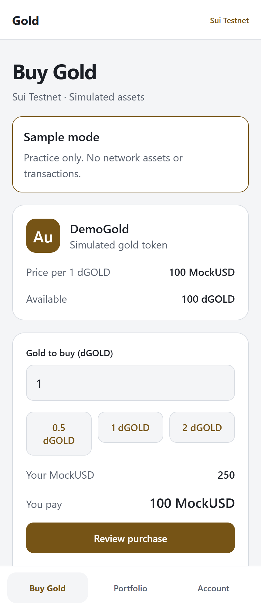
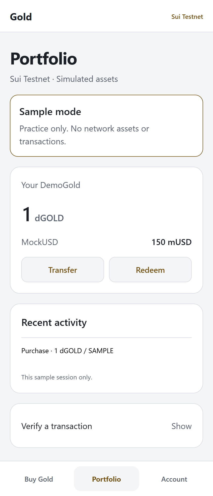
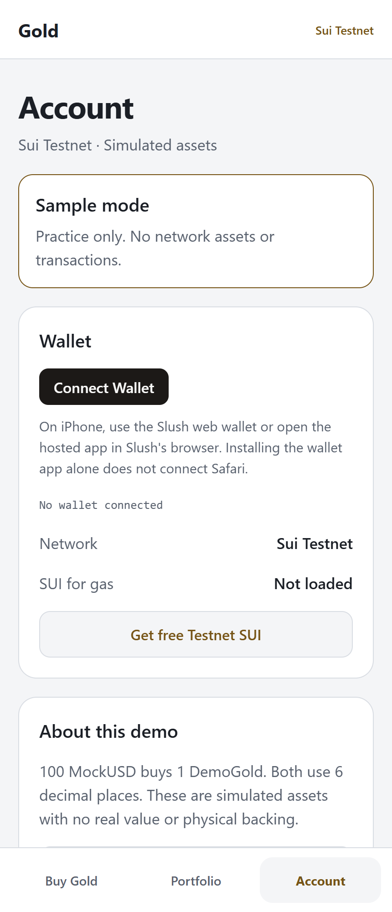

# Tokenized Asset Marketplace

A fixed-price marketplace for simulated gold on **Sui Testnet**, built with **Sui Move, TypeScript, React Native and Expo**. The current app has three tabs: **Buy Gold**, **Portfolio** and **Account**. A purchase exchanges 100 MockUSD for 1 DemoGold atomically; the receipt checks payment and delivery under one transaction digest.

All tokens are simulated, with **no physical backing, monetary value or physical redemption**. Testnet SUI pays gas separately from MockUSD.

## Screenshots

These are actual phone-sized captures of the web app in **sample mode**, not native iPhone screenshots or on-chain purchase evidence. The Portfolio image follows a sample purchase. [Capture details](docs/screenshots/README.md).

<p>
  
  
  
</p>

## What works and what still needs verification

- Move contracts implement inventory-funded atomic purchases with change, issuer capabilities, transfers and escrow-then-burn redemption. **7 Move tests pass.**
- Public Testnet package and marketplace IDs, publication digest and initialization digest are recorded in [deployments/testnet.json](deployments/testnet.json), based on the issuer's CLI transcripts.
- **39 local tests**, the Expo type check, web production export and Android JavaScript export pass. The screenshots exercise the sample browser flow.
- The local service has recorded a confirmed demo funding claim. A successful real purchase digest and the insufficient-payment Testnet dry-run proof are still outstanding. No latency claim is made.
- Native Expo is read-only with an external wallet handoff. **A working iPhone signing flow has not been verified.** HTTP LAN preview is not a complete mobile wallet/funding deployment.

Detailed evidence and historical results: [VALIDATION.md](VALIDATION.md), [mobile/VALIDATION.md](mobile/VALIDATION.md).

## Launch the app

Use **Node.js 24.3 or newer**, npm and an internet connection. Windows commands below use PowerShell and npm.cmd to avoid script-policy errors. On macOS/Linux, use npm instead.

### 1. Install and configure a fresh clone

~~~powershell
git clone https://github.com/bhawishK/Tokenized-Asset-Marketplace.git
cd Tokenized-Asset-Marketplace
npm.cmd ci
npm.cmd --prefix mobile ci
npm.cmd run configure:demo
~~~

The configure command copies only public Testnet IDs from deployments/testnet.json into ignored .env.local and mobile/.env.local files. Existing environment files are preserved. No wallet, private key or funding transaction is created. If using your own deployment, update deployments/testnet.json first. Both dependency lockfiles are committed.

### 2. Explore the interface without issuer access

~~~powershell
npm.cmd --prefix mobile run web -- --host localhost --port 8081
~~~

Open **http://localhost:8081**, then **Account > Try sample mode**. Buy Gold, transfer and redemption rehearsals use session-only sample balances. This route needs no issuer signer or Sui CLI. Ctrl+C stops the server.

### 3. Start the entire local Testnet demo

For the connected-wallet funding flow, install the [official Sui Testnet CLI](https://docs.sui.io/getting-started/onboarding/sui-install), securely configure a dedicated issuer in its local keystore, and fund that issuer with Testnet SUI. The active CLI account must own the IssuerCap for the deployment in deployments/testnet.json. **Cloning the repository does not give you control of the recorded issuer.** Publish your own deployment using the instructions below if you do not own it.

For an issuer that is already configured:

~~~powershell
sui --version
sui client switch --env testnet
$d = Get-Content .\deployments\testnet.json -Raw | ConvertFrom-Json
sui client switch --address $d.issuerAddress
sui client gas
node scripts/demo-faucet.mjs --check
npm.cmd run demo
~~~

Keep the terminal open. The one command starts the issuer service at **http://127.0.0.1:8788** and Expo web at **http://localhost:8081**. If Expo is already running at that address, it is reused; reload its tab. Stop an unrelated app yourself if it owns port 8081. The service can seed a previously empty marketplace once, retains issuer keys in the local CLI keystore, and allows one fixed 250 MockUSD claim per buyer in its persistent record. [Funding policy and recovery](docs/DEMO_FUNDING.md).

In the app:

1. **Account:** connect a separate buyer wallet on Sui Testnet. Exit sample mode.
2. **Account > Demo funds:** select Get 250 demo MockUSD and approve the ownership message. The connected address is used automatically.
3. **Account:** check SUI for gas. If empty, use Get free Testnet SUI with the same buyer wallet. The service's best-effort faucet request does not guarantee funding.
4. **Buy Gold:** choose 1 dGOLD, review and approve the transaction in the wallet.
5. Read the resulting receipt and open its Testnet explorer link. Portfolio refreshes from the network. Funding and purchase receipts are different transactions.

The marketplace contract enforces issuer permissions and price; no client variable grants mint authority. If a transaction was submitted but confirmation failed, check its digest before retrying. Do not delete the service's persistent claim record to retry an uncertain mint.

### Run the components separately

~~~powershell
# Terminal 1, repository root:
npm.cmd run demo:funding

# Terminal 2, repository root:
npm.cmd --prefix mobile run web -- --host localhost --port 8081
~~~

The original Vite frontend is retained for reference: npm.cmd run dev starts it at http://127.0.0.1:5173. The Expo app is the current interface; running both frontends is unnecessary. The funding service's default trusted origins target Expo on localhost:8081, not every origin.

### Phone preview and native builds

For a phone browser preview on the same Wi-Fi, start a separate LAN server:

~~~powershell
npm.cmd --prefix mobile run web -- --host lan --port 8082
~~~

Open the server's HTTP LAN address in Safari or Chrome on your phone, not localhost or the exp:// QR URL. This previews the UI. The issuer service binds to the computer's loopback interface and is unavailable to a phone; **do not expose that signer service publicly**.

For a compatible native development build already installed on the device:

~~~powershell
npm.cmd --prefix mobile run start:device -- --port 8082
~~~

For an SDK-compatible Expo Go installation:

~~~powershell
npm.cmd --prefix mobile run start:go -- --port 8082
~~~

The app uses **Expo SDK 58**. Store Expo Go must match that SDK; installing an incompatible iPhone version will not load the project. Physical iPhone native builds require applicable Apple signing and provisioning; Windows cannot run a local iOS build. Slush's iPhone app does not automatically give Safari a desktop extension connection. A complete phone purchase deployment needs a public HTTPS Expo web URL, a supported wallet connection and a separate phone-accessible funding design. [Expo compatibility](https://docs.expo.dev/troubleshooting/expo-go-version-mismatch/), [Slush integration](https://sdk.mystenlabs.com/slush-wallet/dapp), [native setup details](mobile/README.md).

For Android with the Android SDK, JDK and an emulator or USB device configured, run npm.cmd --prefix mobile run android. This compiles/installs a development build. Native signing still uses the documented external handoff; a native JavaScript export alone does not prove device runtime support.

## Architecture

~~~mermaid
flowchart LR
    W[Buyer wallet] -->|approves message / transaction| UI[Expo app: Buy Gold / Portfolio / Account]
    UI -->|claim with ownership proof| F[Local issuer service: loopback only]
    F -->|issuer CLI / protected capability| S[Sui Testnet]
    UI -->|network reads / buyer transaction| S
    S --> P[Move package]
    P --> M[Shared marketplace: inventory / price / proceeds]
    P --> R[Redemption: escrow then burn]
    S -->|confirmed effects / one purchase digest| UI
    UI --> E[Testnet explorer]
~~~

The public purchase function accepts a MockUSD coin and quantity, withdraws issuer-funded DemoGold, sends the fixed price to the stored proceeds recipient, returns change and emits a purchase event. All asset movements commit or abort together. It never receives mint authority. The UI normally includes 1 extra MockUSD when available to exercise change handling.

| Path | Responsibility |
| --- | --- |
| mobile/src/MarketplaceApp.tsx | Three-tab Expo interface and confirmed receipts |
| mobile/src/wallet.web.tsx | Testnet dApp Kit wallet adapter |
| mobile/src/wallet.tsx | Native read-only account / external handoff |
| src/marketplace-api.ts | Shared chain reads and transaction builders |
| src/domain.ts | Exact integer units and settlement verification |
| contracts/sources/marketplace.move | Purchase, issuer authority and redemption |
| scripts/start-demo.mjs | Starts local funding and Expo web |
| scripts/configure-demo.mjs | Public config generation; preserves existing files |
| scripts/demo-faucet.mjs | Local issuer-funded buyer claims |
| scripts/prove-atomicity.mjs | Real receipt checks and underpayment dry run |

## Units and permissions

| Asset | Move type suffix | Symbol | Decimals | One whole unit |
| --- | --- | --- | --- | --- |
| MockUSD | `mock_usd::MOCK_USD` | mUSD | 6 | 1,000,000 base units |
| DemoGold | `demo_gold::DEMO_GOLD` | dGOLD | 6 | 1,000,000 base units |

**Fixed price: 100 MockUSD = 1 DemoGold.** Both assets use six decimals, so the contract multiplies gold base units by **100** to get the MockUSD cost. For example, 0.5 dGOLD = 500,000 gold base units costs 50,000,000 MockUSD base units. A DemoGold unit does not assert ownership of a gram or ounce of actual gold.

Amounts are `u64` in Move and `bigint` in TypeScript. Quantity must be positive and no greater than `floor(U64_MAX / 100)`. UI inputs support up to six fractional digits and reject floats, exponent notation and overflow. The market's price and proceeds address are set at initialization and have no public setters.

| Action | Required authority |
| --- | --- |
| Initialize marketplace | Own and consume both asset TreasuryCaps |
| Purchase from funded inventory | Buyer-owned MockUSD coin, no issuer authority |
| Transfer DemoGold | Ownership of the transferred coin |
| Request redemption | Ownership of the surrendered coin |
| Mint inventory | Mutable matching `IssuerCap` and marketplace |
| Mint MockUSD to a buyer | Mutable `IssuerCap` |
| Complete redemption and burn | Mutable matching `IssuerCap` and pending request |

Initialization consumes both unique TreasuryCaps into a wallet-owned `IssuerCap`. This capability has `key` **without `store`**, so callers cannot publicly transfer or share it through generic transfer APIs. There is no endpoint to extract either treasury. The Move object ownership rules prevent a buyer from borrowing the issuer's capability. Market-bound administration additionally checks the capability's marketplace ID.

At publication, the two asset TreasuryCaps and the package UpgradeCap initially belong to the publisher. Initialize immediately using the same dedicated issuer account. Retain all privileged capabilities in the issuer wallet; never place them in a shared object or frontend configuration.

The asset modules use the still-supported `coin::create_currency` API for a small, interview-friendly CoinMetadata/OTW model. It is deprecated in favor of `coin_registry::new_currency_with_otw` for new registry integrations. No registry integration is claimed; The package builds and all seven Move tests pass with the recorded Testnet CLI version.

### Redemption lifecycle

1. The holder calls `request_redemption`. The entire supplied coin becomes a balance in a shared `RedemptionRequest`; the holder no longer owns or can transfer those tokens. **Status 0: surrendered, pending in escrow.**
2. The issuer reviews the request and calls `complete_redemption`. The matching capability authorizes a burn of exactly the escrowed quantity. **Status 1: burned, simulated redemption complete.** Escrow is empty and total supply decreases.
3. Completion cannot repeat. The request object remains as a persistent status record and both transitions emit events.

Escrow separates a holder's request from the issuer's completion decision and makes the pending state inspectable. There is no cancellation, refund, physical delivery or external fulfillment service in this small simulation. Do not describe a pending request as burned, or a completed request as physical redemption.

## Contract and frontend checks

Install the CLI using the current [official installation guide](https://docs.sui.io/getting-started/onboarding/sui-install). On a supported shell with `suiup`, select the Testnet toolchain:

```text
suiup install sui@testnet
sui --version
```

The recorded CLI is Sui 1.84.0-9dc25070cf2e. The official guide documents Windows installation. Use the Testnet toolchain and record your actual version.

From `mobile-tokenization-app/`:

~~~powershell
sui move build --path contracts --build-env testnet
sui move test --path contracts --build-env testnet
node --test tests/*.test.mjs mobile/tests/*.test.mjs
npm.cmd --prefix mobile run typecheck
npm.cmd --prefix mobile run build:web
npm.cmd --prefix mobile run build:android
~~~

The Testnet-compatible CLI supplies implicit Sui framework dependencies for this Move 2024 package. Preserve the resulting `Move.lock` after the first successful build. The framework revision is pinned in contracts/Move.lock.

The seven Move tests cover:

- A successful purchase: buyer starts with 250 mUSD, receives 1 dGOLD and 150 mUSD change; seller receives 100 mUSD and no gold; inventory drops from 10 to 9 dGOLD.
- Insufficient payment (`EPayment = 1`).
- Insufficient inventory, with sufficient payment (`EInventory = 2`).
- A mismatched issuer capability is rejected (`EUnauthorized = 3`).
- A buyer cannot obtain the issuer-owned capability from its account inventory.
- Redemption removes the holder's gold, escrows it, then empties escrow, burns supply and records completion.
- Zero-quantity purchase rejection.

**An expected-abort Move unit test does not inspect state after the abort.** It establishes the rejection branch, not an independently observed rollback. Use the Testnet dry-run proof below to inspect failure behavior and compare balances before and after. The JavaScript domain tests do not execute Move.

## Publish your own deployment on Testnet

Skip publication if you already control the issuer for your configured deployment. The checked-in IDs point to an existing demo, not a shared issuer key. After initializing your own marketplace, update the public packageId, marketplaceId, issuerAddress and issuerCapId in deployments/testnet.json. Retain real publication/initialization digests and remove any stale purchase digest. Then update the public IDs in existing local environment files (configure:demo deliberately does not overwrite them).

Use dedicated **issuer and buyer** test accounts, both funded with faucet SUI. Do not use a personal Mainnet wallet. Wallets handle signatures; the frontend and scripts never request keys or seed phrases.

The following PowerShell commands assume an issuer account already securely configured in the Sui CLI keystore outside this repository, and a separate buyer wallet installed in the browser. Creating/importing accounts is a local wallet operation; do not paste recovery material into a terminal transcript, source file or this README.

```powershell
# Add the environment if it is not already listed.
sui client envs
sui client new-env --alias testnet --rpc https://fullnode.testnet.sui.io:443
sui client switch --env testnet
sui client active-env
sui client addresses

# Select the dedicated issuer address or its local alias.
sui client switch --address YOUR_ISSUER_ALIAS_OR_ADDRESS
$issuerAddress = (sui client active-address | Out-String).Trim()
sui client faucet
sui client gas

# Confirm active-env is exactly testnet before publishing.
Push-Location contracts
sui client publish --gas-budget 500000000
Pop-Location
```

If faucet throttling occurs, fund the **public** issuer and buyer addresses using [the Sui Testnet faucet](https://faucet.sui.io/). A buyer needs Testnet SUI for purchase, transfer and redemption gas; minting MockUSD does not supply gas.

Copy the **published package ID** from the publish effects. Use `sui client objects` or the publish effects to find the issuer's `TreasuryCap<...::mock_usd::MOCK_USD>` and `TreasuryCap<...::demo_gold::DEMO_GOLD>` IDs. These are object IDs, not the CoinMetadata IDs. Substitute the full identifiers below:

```powershell
$packageId = '0xYOUR_64_HEX_PACKAGE_ID'
$usdTreasury = '0xYOUR_64_HEX_MOCKUSD_TREASURY_CAP'
$goldTreasury = '0xYOUR_64_HEX_DEMOGOLD_TREASURY_CAP'
$buyerAddress = '0xYOUR_DISTINCT_64_HEX_BUYER_ADDRESS'

# Stores issuer as the fixed proceeds recipient and wraps both treasury caps.
sui client call --package $packageId --module marketplace --function initialize --args $usdTreasury $goldTreasury $issuerAddress --gas-budget 100000000

# Copy the resulting shared Marketplace ID and owned IssuerCap ID from effects.
$marketplaceId = '0xYOUR_64_HEX_SHARED_MARKETPLACE_ID'
$issuerCapId = '0xYOUR_64_HEX_ISSUER_CAP_ID'

# Run inside an ordinary PowerShell session allowed to execute local scripts.
& ./scripts/seed.ps1 -Package $packageId -Marketplace $marketplaceId -IssuerCap $issuerCapId -Buyer $buyerAddress
```

The seed script verifies the CLI environment is `testnet` and the buyer differs from the active issuer. It makes **two separate setup transactions**: mint **100 dGOLD** to inventory, then mint **250 mUSD** to the buyer. Seeding is intentionally not idempotent: running it again adds another 100 dGOLD and 250 mUSD. The script reports partial failure; do not repeat the successful mint if only buyer funding failed.

If script execution is disabled, the equivalent commands, using the same variables, are:

```powershell
sui client call --package $packageId --module marketplace --function mint_inventory --args $issuerCapId $marketplaceId 100000000 --gas-budget 100000000
sui client call --package $packageId --module marketplace --function fund_buyer --args $issuerCapId 250000000 $buyerAddress --gas-budget 100000000
```

For the legacy Vite app and the proof script, fill .env.local with public IDs; the current Expo app also needs the corresponding EXPO_PUBLIC_PACKAGE_ID and EXPO_PUBLIC_MARKETPLACE_ID in mobile/.env.local. Restart the frontend after changes:

```dotenv
VITE_PACKAGE_ID=0xYOUR_64_HEX_PACKAGE_ID
VITE_MARKETPLACE_ID=0xYOUR_64_HEX_SHARED_MARKETPLACE_ID
```

Connect the **funded buyer** wallet, select Testnet, review and confirm a 1 dGOLD purchase. The expected net results are **150 mUSD + 1 dGOLD** in the buyer wallet, **100 mUSD** at the issuer proceeds address and **99 dGOLD** in inventory. Copy the digest from the app's confirmed receipt. Verify both assets under that one digest in the explorer.

For issuer UI actions, connect the same issuer account used to initialize. It must hold the wallet-owned `IssuerCap`; entering an issuer address in a text field grants no permissions. The issuer can also complete a pending redemption from Account > Issuer tools.

## Reproduce the atomicity proof

After one real purchase, run this **read-only** script with its digest. It needs no signer, seed or private key:

```powershell
node --env-file=.env.local scripts/prove-atomicity.mjs --buyer $buyerAddress --success YOUR_SUCCESSFUL_PURCHASE_DIGEST --quantity 3
```

It writes `proofs/atomicity.json` containing public evidence:

1. Fetch the successful Testnet transaction; require success, a Purchase event from this package and marketplace, and the expected fixed price.
2. Verify buyer MockUSD decrease, seller MockUSD increase and buyer DemoGold increase in the **same confirmed transaction's** balance changes.
3. Snapshot buyer and seller balances in both assets and marketplace inventory.
4. Construct a valid MockUSD input strictly below the 3 dGOLD cost, using the buyer's available coins, and call `simulateTransaction` on Testnet. Require a **MoveAbort with EPayment in this package's marketplace module**. Coin-selection or gas errors are not accepted as proof.
5. Require no simulated MockUSD or DemoGold balance movement, re-read the actual balances and inventory, and assert the snapshots match.

This failed purchase case is explicitly a **dry run**. Nothing is submitted and no gas is charged by this script. A submitted transaction that reaches execution and aborts can still charge SUI gas; asset settlement is rolled back. Use idle dedicated test accounts while collecting snapshots so unrelated transfers do not change balances during the proof. If `--success` is omitted, the script verifies only the failure case and says so.

Share the generated proof JSON alongside the README once collected; it is ignored by default so it cannot accidentally masquerade as source-provided evidence. It contains public addresses, not credentials. Replace the nulls in `proofs/example.json` only with real evidence and keep the validation record accurate. No measured Testnet latency is claimed.

### Independent reviewer checks

- Match the receipt digest to the explorer transaction on **Testnet** and check execution status.
- Under balance changes, locate buyer `−100 mUSD`, seller `+100 mUSD`, buyer `+1 dGOLD`, and separate SUI gas. Follow the full coin types back to this package, not just a token symbol.
- Inspect the Move call target, Purchase event, buyer address, quantity and amount paid.
- Inspect the shared marketplace object to confirm inventory, fixed multiplier and proceeds address.
- Re-run the proof script against that digest and your configured deployment.

## 75-second demo script

Before recording: publish, seed 100 dGOLD and 250 mUSD, fund both wallets with faucet SUI, connect the buyer and exit sample rehearsal. Run the read-only proof script ahead of time with a prior real purchase if you want a terminal result ready to show; reset or fund the buyer to make the displayed starting balances match the scenario below.

| Time | Show and say |
| --- | --- |
| 0–12 s | Show the Testnet/simulated-assets label. “This app demonstrates atomic settlement between two Move assets. These tokens have no value or physical backing.” |
| 12–22 s | Show buyer 250 mUSD, 0 dGOLD and inventory 100 dGOLD. “The fixed price is enforced by the contract: 100 MockUSD for one DemoGold.” |
| 22–40 s | Review 1 dGOLD, confirm in the wallet, wait for the actual result. “Payment, delivery, seller proceeds and change happen in one transaction.” Allow extra time for the network or wallet. |
| 40–55 s | Show the refreshed 150 mUSD and 1 dGOLD, open the receipt explorer link. “This single digest shows the buyer's dollar debit, seller's dollar credit and buyer's gold credit.” |
| 55–70 s | Enter 2 dGOLD: the UI displays insufficient funds. Show the proof script's **dry-run** EPayment result with matching pre/post snapshots. “The contract also rejects underpayment; neither simulated asset settles. An executed failure can still charge SUI gas.” |
| 70–85 s | Show Portfolio and issuer role status. “Holders can transfer or surrender tokens to escrow. Only the issuer capability can mint inventory or complete redemption by burning the escrowed tokens.” |

The prepared proof's failing quantity can be 3 dGOLD while the UI uses 2; both cost more than the 150 mUSD remaining. Explain that the proof script is a separate read-only execution, not the UI's blocked submission. Do not call a browser-only sample a Testnet transaction.

## Why Sui fits

Move models coins and capabilities as assets with ownership and type rules rather than ordinary mutable records. MockUSD cannot be substituted with a different coin type, and the purchase function needs no mint authority. Sui transactions can combine transfer and Move operations over both coin types; either the payment and delivery commit together or the transaction aborts. A shared marketplace provides a small, inspectable state object for inventory and immutable pricing parameters.

A comparable issuer-backed asset workflow on **Bitcoin's base layer** would require an additional asset protocol or service to represent and administer the issued assets. Bitcoin's native asset and scripting model do not directly provide this same two-custom-Coin Move workflow. This comparison does not assert that asset protocols on Bitcoin cannot offer their own settlement designs.

## Scope and verification limits

- The portfolio activity feed reads the latest 50 marketplace-module events and then fetches current redemption states. It explicitly reports this window; it is not a full account indexer. Direct `coin` transfers made outside the app are not in this module's event feed. Explorer effects remain authoritative.
- The public Testnet endpoint may throttle, trail execution or become unavailable. Reads are refreshed after `waitForTransaction`; a submitted digest is retained if confirmation lookup fails, so users can check it before retrying.
- Wallet chain support is checked and dApp Kit is configured only for Testnet. No Mainnet endpoint is present.
- Sample mode is session-only and visibly labeled. It provides no issuer privileges and no chain evidence.
- No oracle, audited reserve, custody integration, legal redemption right, production security audit, wallet sponsorship or public faucet is claimed.
- The issuer signs only through its local private CLI configuration. Publication and initialization were supplied in issuer CLI transcripts; a real purchase and atomicity proof are not yet independently verified.

### Browser smoke checklist after installation

Run npm.cmd --prefix mobile run web and check desktop and a 390 px mobile viewport. Verify setup guidance without configuration, sample purchase and insufficient-funds feedback, all three navigation views, keyboard-operated review/cancel and Escape, wallet rejection, Testnet guidance, a real successful purchase receipt and refresh, transfer recipient validation, surrender-to-escrow, issuer-only mint/fund/complete actions, and manual digest lookup. Confirm that a viewer cannot activate issuer actions and that a submitted digest remains visible if subsequent reads fail.

## Resume bullet

Built an Expo/React Native and Sui Move marketplace with atomic settlement of two simulated assets, capability-controlled issuance, escrow-to-burn redemption, confirmed-effects receipts, 7 passing Move tests and 39 local frontend/funding tests.

Link a real purchase transaction only after its effects are verified; the sample screenshots do not establish a live purchase.

## Official references checked

- [Current React dApp Kit setup and wallet execution](https://sdk.mystenlabs.com/dapp-kit/getting-started/react): `@mysten/dapp-kit-react`, `SuiGrpcClient`, `createDAppKit`, `ConnectButton` and `signAndExecuteTransaction`.
- [Sui querying API](https://sdk.mystenlabs.com/sui/clients/querying): balance, BCS object content, recent module events and transaction effects.
- [Execution and simulation](https://sdk.mystenlabs.com/sui/clients/executing): result discrimination, `waitForTransaction` and dry-run semantics.
- [CLI installation](https://docs.sui.io/getting-started/onboarding/sui-install), [client commands](https://www.docs.sui.io/references/cli/client), [Move build/test commands](https://www.docs.sui.io/references/cli/move).
- [Official Coin implementation](https://github.com/MystenLabs/sui/blob/testnet/crates/sui-framework/packages/sui-framework/sources/coin.move) and [scenario testing](https://www.docs.sui.io/develop/testing-debugging/testing).

SDK choices were checked against official documentation. Exact dependencies and lockfiles are committed for both the root and Expo app. Validation records distinguish successful builds and tests from unverified live transactions.
